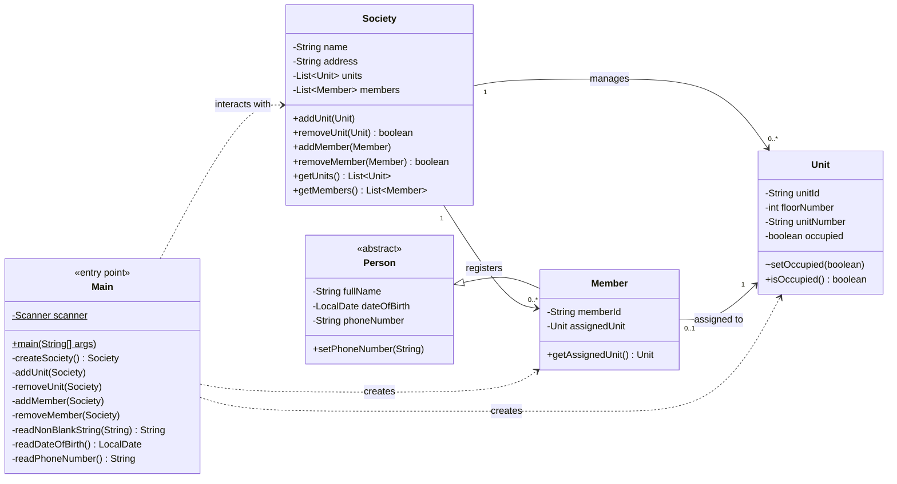
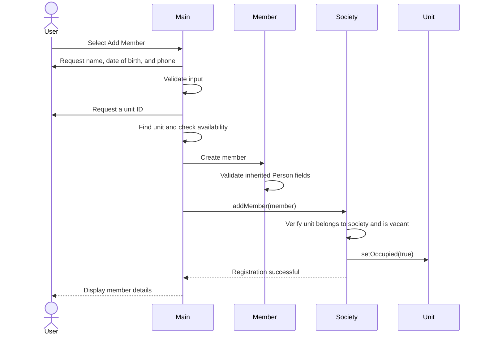
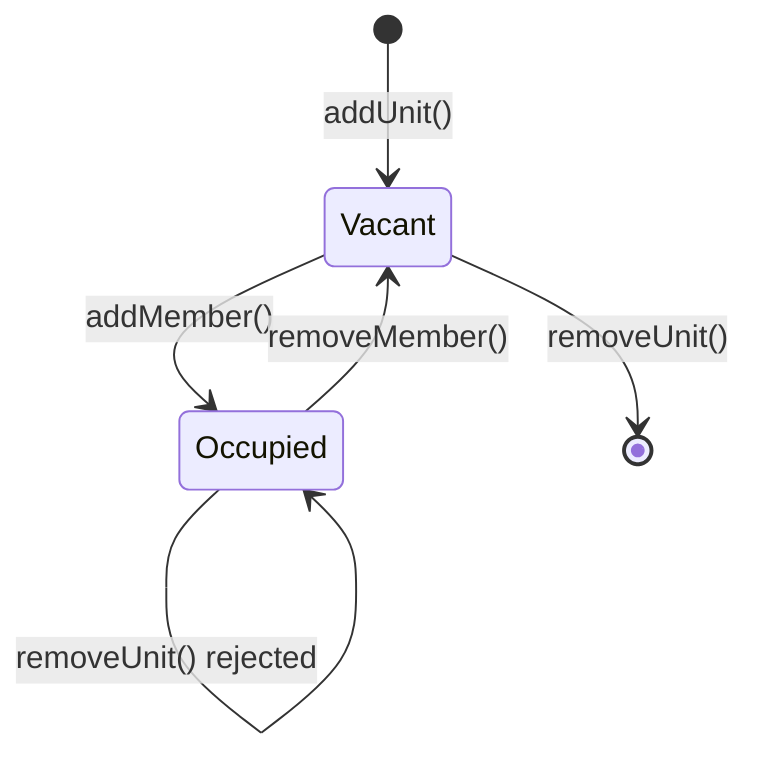

<div align="center">

# 🏢 Housing Management System

**A console-based Housing Management System built with Core Java, demonstrating OOP, input validation, and exception handling.**


[Features](#-features) · [Quick Start](#-quick-start) · [Demo](#-demo) · [Architecture](#-architecture) · [Validation](#-validation--business-rules)

</div>

---

## 📌 Overview

This project is a console application for managing a housing society. It models societies, housing units, and residents using Core Java and object-oriented programming.

The application keeps business rules in the domain classes, validates user input, and prevents inconsistent states such as assigning multiple members to the same unit or removing an occupied unit.

**Project scope:** 529 lines of Java across five source files. No external dependencies or build tools are required.

---

## ✨ Features

| Option | Feature | Description |
|:---:|---|---|
| 0 | Society Details | Displays the society name, address, and unit/member counts |
| 1 | Add Unit | Adds a unit using its floor number and unit number |
| 2 | Remove Unit | Removes a unit by ID; occupied units cannot be removed |
| 3 | List Units | Displays all units and their occupancy status |
| 4 | Add Member | Registers a member and assigns them to a vacant unit |
| 5 | Remove Member | Removes a member and makes their unit vacant |
| 6 | List Members | Displays all registered members and their assigned units |
| 7 | Exit | Exits the application |

---

## 🚀 Quick Start

**Prerequisite:** JDK 17 or newer.

```bash
# Clone the repository
git clone https://github.com/devnischandra/java-console-housing-management-system.git
cd java-console-housing-management-system

# Compile the source files
mkdir -p out
javac -d out *.java

# Run the application
java -cp out Main
```

---

## 🎬 Demo

<details open>
<summary><b>Example session</b> (UUIDs shortened for readability)</summary>

```text
Welcome to the Housing Management System!
Creating a new society...
Enter society name: Green Valley
Enter society address: 12 Park Road
Society created: Society Name: Green Valley, Address: 12 Park Road, Total Units: 0, Total Members: 0

Menu:
0. Society Details
1. Add Unit
2. Remove Unit
3. List Units
4. Add Member
5. Remove Member
6. List Members
7. Exit
Choose an option: 1
Enter floor number: 2
Enter unit number: 204
Unit added: Unit ID: 3f2b9c1e-…, Unit Number: 204, Floor Number: 2, Occupied: false

Choose an option: 4
Enter member name: Asha Rao
Enter date of birth (YYYY-MM-DD): 1998-07-14
Enter phone number: +91 98765-43210
Enter assigned unit ID: 3f2b9c1e-…
Member added: Member ID: 7a41d0b8-…, Name: Asha Rao, Date of Birth: 1998-07-14, Phone Number: +919876543210, Assigned Unit: Unit ID: 3f2b9c1e-…, Unit Number: 204, Floor Number: 2, Occupied: true

Choose an option: 2
Enter unit ID to remove: 3f2b9c1e-…
Unable to remove unit: An occupied unit cannot be removed.
```

</details>

---

## 🏗 Architecture

### Class diagram



### Class responsibilities

| Class | Responsibility |
|---|---|
| `Main` | Console menu, user interaction, input parsing, and user-friendly validation |
| `Society` | Maintains units and members and enforces the rules between them |
| `Unit` | Represents a housing unit and tracks its occupancy |
| `Person` | Abstract base class containing a member's name, date of birth, and phone number |
| `Member` | Represents a resident and stores their assigned unit |

### Member registration flow



### Unit occupancy lifecycle



An occupied unit cannot be removed; the operation throws an `IllegalStateException`.

---

## 🛡 Validation & Business Rules

### Input validation

| Input | Rule |
|---|---|
| Names, address, unit number, and IDs | Must not be blank |
| Menu choice and floor number | Must be integers; floor number must be non-negative |
| Date of birth | Must use `YYYY-MM-DD` and cannot be in the future |
| Phone number | Must contain 7–15 digits, with an optional leading `+`; spaces, hyphens, and parentheses are removed |

The console interface re-prompts users when input is invalid.

### Domain rules

| Rule | Enforced by |
|---|---|
| Society name and address cannot be blank | `Society` constructor |
| Floor number cannot be negative; unit number cannot be blank | `Unit` constructor |
| Duplicate floor/unit combinations are not allowed (case-insensitive unit number) | `Society.addUnit()` |
| Occupied units cannot be removed | `Society.removeUnit()` |
| A member's assigned unit must belong to the society | `Society.addMember()` |
| A unit can have only one current member | `Society.addMember()` |
| Removing a member makes their unit vacant | `Society.removeMember()` |
| Member name, date of birth, and phone number are validated | `Person` constructor |

**Why validate at both levels?** The console validates input to provide useful prompts. The domain classes validate again to protect the application's data rules independently of the interface.

---

## 🧠 Design Decisions

- **Encapsulation:** `getUnits()` and `getMembers()` return unmodifiable list views, preventing callers from directly changing the society's collections.
- **Domain-level rules:** `Society` checks unit ownership and occupancy when members are added or removed.
- **Controlled occupancy updates:** `Unit.setOccupied()` is package-private, meaning any class in the same package can access it. The application uses `Society` to update occupancy during member registration and removal.
- **Immutability:** Identifiers, names, dates of birth, and assigned units are final where appropriate.
- **UUID identifiers:** UUIDs provide practically unique IDs without manual ID generation.
- **Exception handling:** Domain classes throw specific exceptions for invalid data or rule violations; the console interface catches expected exceptions and displays readable messages.
- **Graceful input termination:** The application handles a closed input stream and closes its `Scanner` in a `finally` block.

---

## 🧪 Manual Test Checklist

Use these scenarios to verify the application's behaviour:

| Scenario | Expected result |
|---|---|
| Enter a blank society name | User is prompted again |
| Add a unit with floor `-1` | User is prompted again |
| Add the same floor and unit number twice | Duplicate unit is rejected |
| Add a member before adding any unit | Registration is stopped with an explanatory message |
| Enter a future date of birth | Date is rejected |
| Enter an invalid phone number such as `12-34` | Phone number is rejected |
| Assign a second member to an occupied unit | User is asked to choose another unit |
| Remove an occupied unit | Removal is rejected |
| Remove a member, then remove their unit | Both operations succeed |
| Enter non-numeric or unsupported menu choices | An error message is displayed |
| Close the input stream | Application exits gracefully |

---

## 📁 Project Structure

```text
java-console-housing-management-system/
├── Main.java
├── Society.java
├── Unit.java
├── Person.java
├── Member.java
├── README.md
└── .gitignore
```

---

## 🎓 Concepts Demonstrated

| Concept | Example in this project |
|---|---|
| Inheritance and abstraction | `Member` extends abstract class `Person` |
| Encapsulation | Private fields and unmodifiable collection views |
| Composition and object relationships | `Society` manages units and members |
| Exception handling | Specific exceptions with `try`, `catch`, and `finally` |
| Input validation | String checks, regular expressions, and `java.time` |
| Collections and Streams | `ArrayList`, `List`, and `anyMatch()` |
| Modern Java | Arrow-style `switch`, `String.isBlank()`, and `Objects.requireNonNull()` |

---

## ⚠️ Known Limitations

- **In-memory storage:** All data is lost when the application exits.
- **Single society:** One society is created per application run.
- **Linear lookups:** Units and members are searched using list iteration (`O(n)`).
- **UUID entry:** Users must enter unit and member IDs manually.
- **No automated tests:** The project currently includes a manual test checklist, not an automated test suite.
- **No build tool or package structure:** The project uses plain Java source files and the default package.

---

## 👤 Author

**Nishant Chandra**

- GitHub: [@devnischandra](https://github.com/devnischandra)
- LinkedIn: [Nishant Chandra](https://www.linkedin.com/in/devnischandra/)

Feedback and suggestions are welcome. Feel free to open an issue.
